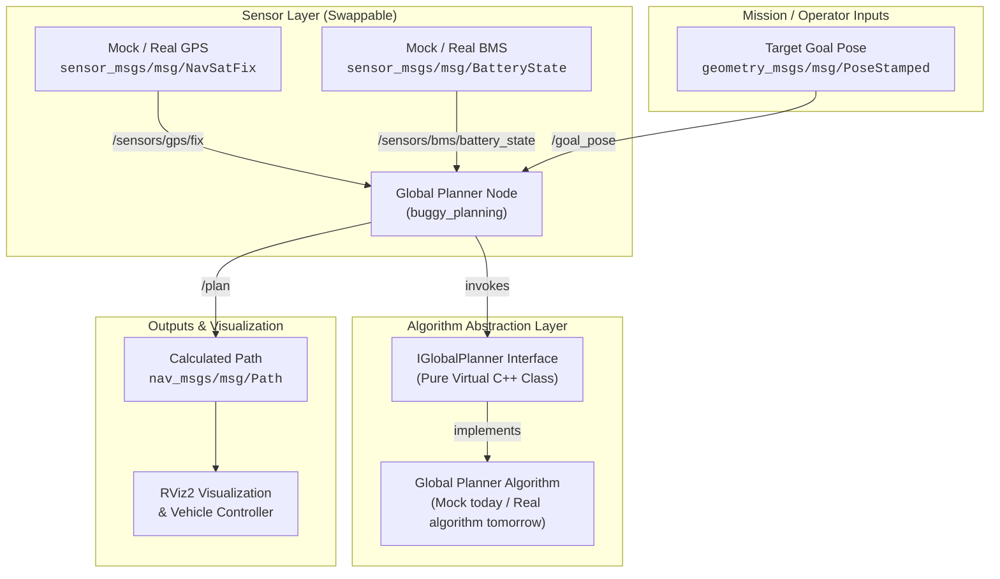

# Autonomous Buggy — ROS 2 Jazzy System Guide

A clean, modular ROS 2 Jazzy communication network and abstraction boilerplate for the Autonomous Buggy Campus Navigation Project.

---

## 1. System Overview

This repository provides the core ROS 2 infrastructure connecting vehicle sensors, vehicle power monitoring, destination goals, and route planning.

The architecture strictly decouples sensor hardware from algorithms:
- **Sensors Stream Canonical Messages**: All producers (mock or real) publish standard ROS 2 message types to fixed topics.
- **Planner Node Integrates**: Subscribes to GPS, BMS, and destination goals.
- **Algorithm is Abstracted**: The Global Planner algorithm is isolated behind a clean C++ abstraction layer (`IGlobalPlanner`), ready for handover from the algorithm team.
- **Hardware is Swappable**: Transitioning from mock data to real vehicle hardware requires no code changes—only a launch argument toggle.

---

## 2. System Architecture



---

## 3. Package Breakdown

The codebase is organized into three single-responsibility ROS 2 packages inside `src/`:

### 1. `buggy_sensors`
- **Purpose**: Generates realistic vehicle sensor telemetry for simulation and testing.
- **Nodes**:
  - `mock_gps_node`: Publishes standard GPS fix coordinates and covariance at 5 Hz with configurable motion modes (circular campus route, linear path, or static origin).
  - `mock_bms_node`: Publishes battery state telemetry (nominal 48V pack, state-of-charge percentage, continuous discharge model, temperature, and current draw) at 1 Hz.
- **Configuration**: YAML file in `config/mock_sensors.yaml`.

### 2. `buggy_planning`
- **Purpose**: Houses the Global Planner abstraction layer and the ROS 2 integration node.
- **Key Components**:
  - `i_global_planner.hpp`: Abstract C++ interface defining the contract between ROS 2 and any routing algorithm.
  - `mock_global_planner.cpp`: Default reference implementation with battery-level safety gating and great-circle waypoint interpolation.
  - `global_planner_node.cpp`: ROS 2 node managing subscriptions, state verification, algorithm invocation, and path publication.
- **Configuration**: YAML file in `config/planner_params.yaml`.

### 3. `buggy_bringup`
- **Purpose**: Centralized startup orchestration, modular launch files, and visualizer profiles.
- **Key Components**:
  - `simulation.launch.py`: One-command startup of mock sensors, planner node, static coordinate transforms, and optional RViz2.
  - `buggy.launch.py`: Master hardware bringup with runtime switches (`use_mock_gps`, `use_mock_bms`).
  - `rviz/buggy_view.rviz`: Pre-configured RViz display profile showing map grid, TF tree, vehicle frames, and route visualization.

---

## 4. Communication Interface Contract

All components communicate over canonical topics using standard ROS 2 interfaces:

| Canonical Topic | Message Type | Rate | Description |
| :--- | :--- | :--- | :--- |
| `/sensors/gps/fix` | `sensor_msgs/msg/NavSatFix` | 5.0 Hz | High-precision vehicle coordinates (latitude, longitude, altitude) and fix quality |
| `/sensors/bms/battery_state` | `sensor_msgs/msg/BatteryState` | 1.0 Hz | Battery pack status (voltage, percentage, discharge current, health) |
| `/goal_pose` | `geometry_msgs/msg/PoseStamped` | On Demand | Target destination pose selected by operator or RViz "2D Goal Pose" tool |
| `/plan` | `nav_msgs/msg/Path` | On Calculation | Timestamped array of ordered waypoints leading to destination |

---

## 5. Handover Guide for Global Planner Team

The ROS 2 team handles all integration, threading, transforms, and messaging. The Global Planner team only needs to satisfy the abstraction boundary defined in `i_global_planner.hpp`:

### What the Algorithm Receives (Inputs)
1. **Current GPS**: `sensor_msgs::msg::NavSatFix` (current latitude, longitude, fix status).
2. **Current BMS**: `sensor_msgs::msg::BatteryState` (battery percentage, voltage).
3. **Target Destination**: `geometry_msgs::msg::PoseStamped` (target coordinates and orientation).

### What the Algorithm Returns (Outputs)
- `PlannerResult` structure containing:
  - `success`: Boolean indicating if a valid route was found.
  - `message`: Informative status or failure reason (e.g., "Insufficient battery", "Target unreachable").
  - `path`: Standard `nav_msgs::msg::Path` containing the sequence of waypoints.
  - `estimated_distance_m`: Total distance of the planned route in meters.
  - `estimated_duration_s`: Estimated traversal time in seconds.

### How Integration Works
1. The algorithm team provides their C++ class inheriting from `buggy_planning::IGlobalPlanner`.
2. They implement `initialize(map_path, min_battery)` and `compute_route(gps, bms, goal)`.
3. In `global_planner_node.cpp`, the planner instance is injected—requiring zero changes to sensors, topics, or launch files.

---

## 6. Hardware Swappability Guide

The architecture enables seamless transition from software testing to physical vehicle driving:

```
Mock Mode (Current)                     Hardware Mode (Vehicle)
┌───────────────────────┐               ┌───────────────────────┐
│     mock_gps_node     │               │   physical GPS driver │
└──────────┬────────────┘               └──────────┬────────────┘
           │                                       │
           ▼                                       ▼
    /sensors/gps/fix                        /sensors/gps/fix
           │                                       │
           └───────────────────┬───────────────────┘
                               │
                               ▼
                   ┌───────────────────────┐
                   │  global_planner_node  │
                   └───────────────────────┘
```

### Launching in Different Modes

- **Full Simulation / Mock Data** (Default for development):
  ```bash
  ros2 launch buggy_bringup buggy.launch.py use_mock_gps:=true use_mock_bms:=true
  ```

- **Hybrid Mode** (Real GPS connected, mock BMS):
  ```bash
  ros2 launch buggy_bringup buggy.launch.py use_mock_gps:=false use_mock_bms:=true
  ```

- **Full Vehicle Hardware** (Real GPS and real BMS drivers):
  ```bash
  ros2 launch buggy_bringup buggy.launch.py use_mock_gps:=false use_mock_bms:=false
  ```

---

## 7. Quick Start & Execution

### 1. Build the Workspace

```bash
cd ~/Code/autonomous
colcon build --symlink-install
source install/setup.bash
```

### 2. Launch Simulation Pipeline

Start all mock sensor nodes, planner node, and static coordinate transforms:
```bash
ros2 launch buggy_bringup simulation.launch.py
```

### 3. Launch with RViz2 Visualizer

Start the entire system with visual display:
```bash
ros2 launch buggy_bringup simulation.launch.py rviz:=true
```

To set a destination:
1. In RViz, click the **"2D Goal Pose"** button in the top toolbar.
2. Click any location on the grid.
3. The Global Planner immediately reads mock GPS & BMS, generates the route, and displays the green path.

### 4. Trigger Route via Terminal

Alternatively, publish a destination pose directly:
```bash
ros2 topic pub --once /goal_pose geometry_msgs/msg/PoseStamped "{
  header: {frame_id: 'map'},
  pose: {position: {x: 30.0, y: 15.0, z: 0.0}, orientation: {w: 1.0}}
}"
```

### 5. Run Verification Tests

Run the unit test suite:
```bash
colcon test --packages-select buggy_planning
colcon test-result --verbose
```

---

## 8. Directory Structure

```
autonomous/
├── .gitignore
├── README.md
├── ROS2_SETUP.md
├── autonomous_buggy_plan.md
└── src/
    ├── buggy_bringup/
    │   ├── CMakeLists.txt
    │   ├── package.xml
    │   ├── launch/
    │   │   ├── buggy.launch.py
    │   │   └── simulation.launch.py
    │   └── rviz/
    │       └── buggy_view.rviz
    ├── buggy_planning/
    │   ├── CMakeLists.txt
    │   ├── package.xml
    │   ├── config/
    │   │   └── planner_params.yaml
    │   ├── include/buggy_planning/
    │   │   ├── global_planner_node.hpp
    │   │   ├── i_global_planner.hpp
    │   │   └── mock_global_planner.hpp
    │   ├── src/
    │   │   ├── global_planner_node.cpp
    │   │   └── mock_global_planner.cpp
    │   └── test/
    │       └── test_planner.cpp
    └── buggy_sensors/
        ├── CMakeLists.txt
        ├── package.xml
        ├── config/
        │   └── mock_sensors.yaml
        ├── include/buggy_sensors/
        │   ├── mock_bms_node.hpp
        │   └── mock_gps_node.hpp
        └── src/
            ├── mock_bms_node.cpp
            └── mock_gps_node.cpp
```
