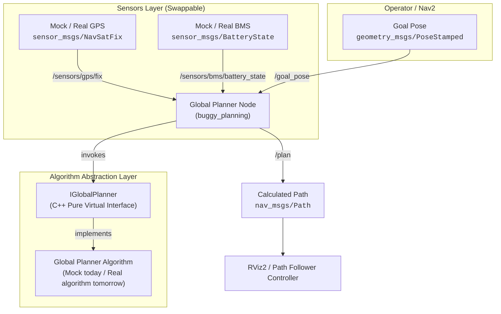

# Autonomous Buggy — ROS 2 Jazzy Boilerplate

A modular, production-ready ROS 2 Jazzy workspace and communication architecture for the Autonomous Buggy Campus Navigation project.

---

## 1. System Architecture



---

## 2. Canonical Topic Interface Contract

All sensor drivers and downstream nodes adhere to standard ROS 2 message types to guarantee seamless drop-in hardware swapping:

| Topic Name | Message Type | Frequency | Description |
| :--- | :--- | :--- | :--- |
| `/sensors/gps/fix` | `sensor_msgs/msg/NavSatFix` | 5.0 Hz | Vehicle GPS coordinates, RTK fix status, and covariance |
| `/sensors/bms/battery_state` | `sensor_msgs/msg/BatteryState` | 1.0 Hz | Battery voltage (48V), state-of-charge percentage, health |
| `/goal_pose` | `geometry_msgs/msg/PoseStamped` | On Demand | Target destination pose (from RViz2 "2D Goal Pose" or mission controller) |
| `/plan` | `nav_msgs/msg/Path` | On Plan / Dynamic | Computed global route waypoints from current location to destination |

---

## 3. Global Planner Abstraction Layer (`IGlobalPlanner`)

The ROS 2 team is solely responsible for integration. To integrate the Global Planner algorithm being handed over tomorrow, the algorithm team implements the clean C++ interface [`IGlobalPlanner`](file:///home/vj/Code/autonomous/src/buggy_planning/include/buggy_planning/i_global_planner.hpp):

```cpp
#include "buggy_planning/i_global_planner.hpp"

class CampusRoadPlanner : public buggy_planning::IGlobalPlanner
{
public:
  bool initialize(const std::string & map_path, double min_battery_threshold) override {
    // 1. Load campus road graph / roadmap
    return true;
  }

  buggy_planning::PlannerResult compute_route(
    const sensor_msgs::msg::NavSatFix & current_gps,
    const sensor_msgs::msg::BatteryState & current_bms,
    const geometry_msgs::msg::PoseStamped & goal_pose) override
  {
    buggy_planning::PlannerResult result;

    // 2. Validate vehicle BMS state-of-charge
    if (current_bms.percentage < 0.15f) {
      result.success = false;
      result.message = "Battery too low for autonomous route";
      return result;
    }

    // 3. Compute route using campus road network
    // result.path = ...
    result.success = true;
    return result;
  }
};
```

---

## 4. Hardware Swappability

All mock sensor nodes publish to the exact same canonical topics as the real hardware drivers. Switching between mock and real sensors requires **zero downstream code changes**:

```bash
# Launch with full mock sensor streaming (Default):
ros2 launch buggy_bringup buggy.launch.py use_mock_gps:=true use_mock_bms:=true

# Seamless swap when real GPS hardware is connected:
ros2 launch buggy_bringup buggy.launch.py use_mock_gps:=false use_mock_bms:=true

# Seamless swap for full production vehicle:
ros2 launch buggy_bringup buggy.launch.py use_mock_gps:=false use_mock_bms:=false
```

---

## 5. Quick Start

### Build Packages

```bash
cd ~/Code/autonomous
colcon build --symlink-install
source install/setup.bash
```

### Run Simulation Pipeline

```bash
# Launch mock GPS, mock BMS, transforms, and Global Planner:
ros2 launch buggy_bringup simulation.launch.py
```

### Launch with RViz2 Visualizer

```bash
# Launch simulation pipeline and auto-start RViz2:
ros2 launch buggy_bringup simulation.launch.py rviz:=true
```

In RViz2, use the **"2D Goal Pose"** tool on the toolbar to click any destination point on the grid. The Global Planner will immediately read the latest mock GPS & BMS telemetry, compute the route, and display the path in green.

### Trigger Route via Command Line

```bash
ros2 topic pub --once /goal_pose geometry_msgs/msg/PoseStamped "{
  header: {frame_id: 'map'},
  pose: {position: {x: 25.0, y: 15.0, z: 0.0}, orientation: {w: 1.0}}
}"
```

### Run Unit Tests

```bash
colcon test --packages-select buggy_planning
colcon test-result --verbose
```
